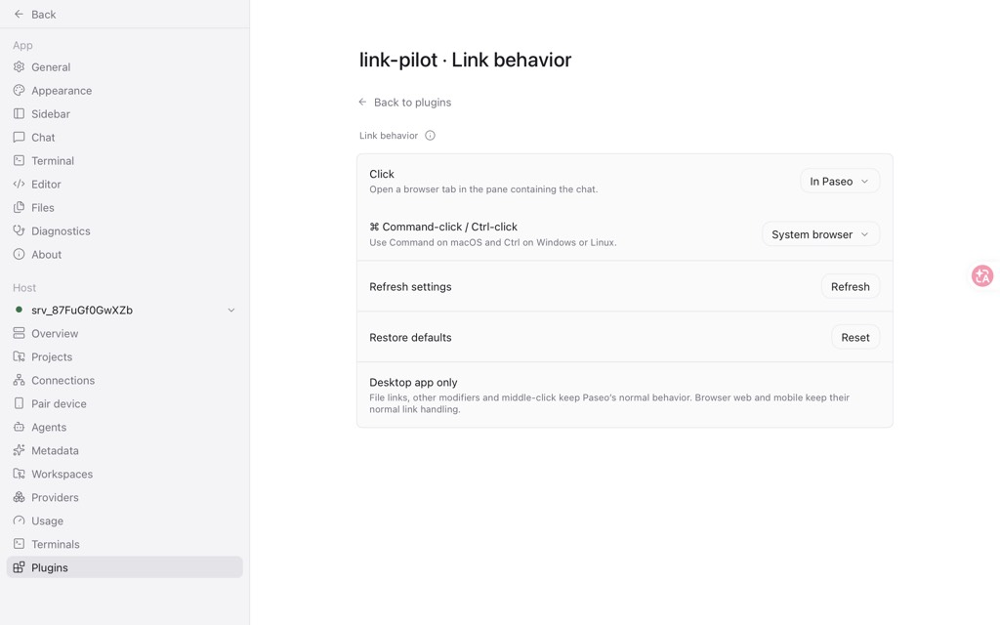

# Link Pilot

Choose where a click takes you from an assistant's web link: a browser tab in the same Paseo pane, or your system browser.

| Gesture                                             | Default        | Available destinations    |
| --------------------------------------------------- | -------------- | ------------------------- |
| Click                                               | In Paseo       | In Paseo / System browser |
| Command-click on macOS; Ctrl-click on Windows/Linux | System browser | In Paseo / System browser |

Open **Settings → Plugins → Link Pilot → Link behavior**, or search for **Link Pilot settings** in Command Center. Changes save automatically to the host installation. Each eligible click reads current settings, including changes made in another window. The settings page follows Paseo's English or Chinese language setting.

Enable Link Pilot on one host per app. That installation’s preferences apply to assistant chat links across connected hosts.



## Install

Requires the Paseo **desktop app and daemon 0.13.x**. The app's internal browser adapter is checked at runtime; unsupported app internals leave native link handling active.

```sh
paseo plugin add git:xzthemeofsss/paseo-plugins:plugins/link-pilot --ref codex/link-pilot
```

If upgrading from the earlier local prototype, disable it first:

```sh
paseo plugin disable in-app-links
```

The runtime ID is `link-pilot`. This is a direct Git installation; the marketplace listing is being prepared.

## Scope and data

Only HTTP(S) links inside visible assistant chat messages are intercepted. In-app destinations open in the source chat's pane, even when another pane has focus. File references, downloads, user messages, Shift/Alt-click, middle-click and macOS Ctrl-click keep Paseo's normal behavior. Browser web and mobile retain native link handling; their settings page can still edit the host preferences.

The plugin reads the clicked URL and label, active workspace and pane context, saved preferences, and Paseo's own same-origin JavaScript bundle. It uses private app interfaces for source-pane placement and validates them before attaching the listener. A future Paseo update can require an adapter update.

There is no plugin backend or telemetry service. Preferences are stored by the Paseo daemon. Opening a link contacts that URL through Paseo's browser or your system browser. The plugin does not send chat messages, call an AI provider, or install software at runtime. If settings cannot be read or opening fails after the click is intercepted, a dismissible error appears instead of trying another destination.

## Development and validation

```sh
npm ci --ignore-scripts
npm run typecheck
npm run lint
npm test
npm run probe
npm run format
npm pack --dry-run --ignore-scripts
```

The focused integration suite reads the installed macOS Paseo app's real Markdown link renderer and pure routing/file-classification modules. Set `PASEO_BUNDLE` to a packaged desktop entry JavaScript file on another machine. Browser stores and navigation are controlled test fixtures. Tests do not contact a daemon or open real external websites.

Tested against macOS Paseo 0.13.0: source-pane navigation, both destinations for both gestures, Windows/Linux modifier policy in fixtures, settings read errors, disposal, and changed source context. Windows/Linux desktop operation and native devices have not been independently exercised.

See [the English listing](OVERVIEW.md), [中文介绍](OVERVIEW.zh-CN.md), and [marketplace submission draft](MARKETPLACE.md).
